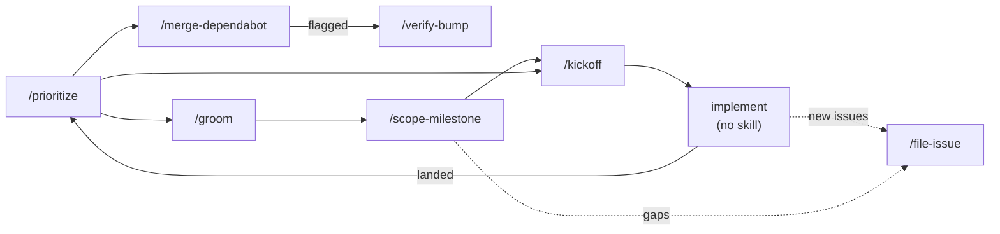
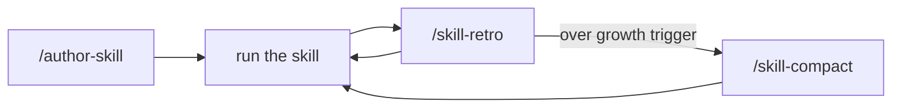

# Claude Code Config

Shared skills and configuration for Claude Code, versioned as `~/.claude`.
Primarily versioning my own setup, but meant to be usable by others —
fork it and make it yours.

## Skills

### Repo upkeep

| Skill | Summary | Suggested model | Maturity |
| --- | --- | --- | --- |
| [`prioritize`](skills/prioritize/SKILL.md) | Decide what to work on next across your GitHub repos. | Sonnet | 🧪 Experimental |
| [`kickoff`](skills/kickoff/SKILL.md) | Pick the one thing to start with in the repo you just entered. | Opus | 🟢 Usable |
| [`merge-dependabot`](skills/merge-dependabot/SKILL.md) | Clear the Dependabot PRs that are actually safe to merge. | Sonnet | 🟢 Usable |
| [`verify-bump`](skills/verify-bump/SKILL.md) | Land a dependency bump that green CI alone doesn't prove safe. | Opus | 🟢 Usable |
| [`groom`](skills/groom/SKILL.md) | Clear the dead and duplicated issues out of one repo's backlog. | Opus | 🟢 Usable |
| [`scope-milestone`](skills/scope-milestone/SKILL.md) | Say what the next milestone promises, and which issues it needs. | Opus | 🟢 Usable |
| [`file-issue`](skills/file-issue/SKILL.md) | File an issue someone could start cold, or refine a rough one to that bar. | Opus | 🟢 Usable |

### Repo setup & toolchain

| Skill | Summary | Suggested model | Maturity |
| --- | --- | --- | --- |
| [`add-devcontainer`](skills/add-devcontainer/SKILL.md) | Pin a repo's toolchain in a devcontainer and run CI inside it. | Opus | 🧪 Experimental |
| [`add-dependabot`](skills/add-dependabot/SKILL.md) | Set up a repo's Dependabot config so bumps arrive in mergeable batches. | Sonnet | 🧪 Experimental |
| [`upgrade-toolchain`](skills/upgrade-toolchain/SKILL.md) | Move a pinned toolchain version across every place a repo pins it. | Sonnet | 🧪 Experimental |

### Skill lifecycle

| Skill | Summary | Suggested model | Maturity |
| --- | --- | --- | --- |
| [`author-skill`](skills/author-skill/SKILL.md) | Capture a session's workflow as a new skill, or refine an existing one. | Fable | 🧪 Experimental |
| [`skill-retro`](skills/skill-retro/SKILL.md) | Improve a skill right after running it, from observed friction. | Opus | 🟢 Usable |
| [`skill-compact`](skills/skill-compact/SKILL.md) | Shrink a skill that has accreted more rules than it needs. | Opus | 🧪 Experimental |
| [`instructions-retro`](skills/instructions-retro/SKILL.md) | Check whether `CLAUDE.md` and friends helped or misled a run without a skill. | Opus | 🧪 Experimental |

### Session helpers

| Skill | Summary | Suggested model | Maturity |
| --- | --- | --- | --- |
| [`grilling`](skills/grilling/SKILL.md) | Stress-test a plan or idea through relentless questioning. | Opus | 🧪 Experimental |
| [`pick-model`](skills/pick-model/SKILL.md) | Pick the cheapest Claude model that still fits the task. | Sonnet | 🟢 Usable |
| [`claude-md-compact`](skills/claude-md-compact/SKILL.md) | Shrink `CLAUDE.md` when global preferences have accreted. | Opus | 🟢 Usable |

Maturity: 🚧 WIP → 🧪 Experimental → 🟢 Usable → 🛡️ Battle-tested — judged
from each skill's history log by `/skill-retro`; the promotion bars live in
[`bin/skill-refiner`](bin/skill-refiner/Maturity.fs).

"Suggested model" is the model to *run* a skill with. Writing or refining a
skill is different — switch to the most capable model first; the threshold and
rationale live in
[references/skill-conventions.md](references/skill-conventions.md).

## Workflows

Some skills are meant to run in sequence. These are starting points, not fixed
pipelines — each skill also stands alone.

**Setting a repo up** (once) — run `/add-devcontainer`, then
`/add-dependabot`.

**Working on repos** (every session)



- Start with `/prioritize`, then `cd` into the repo it points at:
  - dependency bumps → `/merge-dependabot`; for a flagged bump you still want
    to land, `/verify-bump <n>`
  - an issue list you can no longer hold in your head → `/groom`
  - no milestone, or one whose promise has drifted → `/scope-milestone`, which
    gives `/kickoff` its tier-3 focus; it grooms nothing itself, so run
    `/groom` first when it says the backlog can't carry a promise
  - choosing what to start on → `/kickoff`
  - issues that come out of the work → `/file-issue`, which also refines a
    rough one
- Doing the work is the one step no skill drives, deliberately: `/kickoff` and
  `/file-issue` both stop short of it, and `CLAUDE.md` already governs it in
  every session — a skill would restate those rules at a cost per run.
  Repo-specific mechanics (branching, how PRs land, which checks run) belong in
  that repo's `AGENTS.md` or its own `.claude/skills`.
- Issues noticed mid-work stay proposals until the run ends; once the change is
  landed, re-enter at `/kickoff` for the next one, or `/prioritize` when you are
  done in that repo.
- Dependabot doesn't move the versions `/add-devcontainer` pinned; when a
  toolchain is out of date, run `/upgrade-toolchain`.

**Skills**



- **Capturing a workflow** — run `/author-skill` in the session that revealed
  it, while the context is fresh. A workflow specific to one project lands in
  that repo's `.claude/skills`.
- **Refining after use** — below 🟢 Usable the skill's footer settles it: a
  run that met friction, or that you corrected, gets `/skill-retro` in the same
  session; one that met none logs itself as a bare `run`. From 🟢 Usable up
  there is no footer, and only a reviewed run counts toward 🛡️ Battle-tested —
  run `/skill-retro` when a run felt off, or when you want the skill to earn
  the top rung. When it
  reports the skill over the growth trigger, run `/skill-compact` as a separate
  pass.
- **Project skills** work the same: run the commands from inside that repo, and
  the log, edits, and maturity table (`.claude/skills/README.md`) land beside
  the skill.

**Global preferences** — after a session worked from plain prompts rather than
a skill, run `/instructions-retro` to review how `CLAUDE.md`, `references/`,
memory, and optionally the project's own instruction files steered it; its
findings accumulate in `references/instructions-history.md`. `standards/`
files a session read are reviewed the same way.

Run `/claude-md-compact` when `~/.claude/bin/claude-md-growth.sh` reports
`CLAUDE.md` over its trigger; `/instructions-retro` runs that check whenever it
edits the file. The trigger is growth since the last pass, not size, because
cutting alone does not hold the size down. Moving a rule that holds only for
one kind of work into a standard does, and the pass proposes those moves too.

## Setup

```sh
git clone https://github.com/NicoVIII/claude-config.git ~/.claude
```

If `~/.claude` already exists:

```sh
cd ~/.claude
git init -b main
git remote add origin https://github.com/NicoVIII/claude-config.git
git pull origin main
git branch --set-upstream-to=origin/main main
```

`git pull` refuses to overwrite untracked files, so move an existing
`CLAUDE.md`, `README.md`, or `skills/` aside first and merge back what you want
to keep.

## After cloning

- Or skip the installing: open the repo in its
  [devcontainer](.devcontainer/devcontainer.json) and everything below is already
  there at a pinned version. It bind-mounts the host's `~/.claude`, so Claude
  Code inside the container shares your skills, memory **and login** read-write —
  convenient for working on this config, not a sandbox.
- Install what the skills shell out to: [`gh`](https://cli.github.com/),
  authenticated (`prioritize`, `merge-dependabot` and `verify-bump` are built on
  it), the [.NET SDK](https://dotnet.microsoft.com/download) 10 or newer
  (`prioritize`'s gather step, `merge-dependabot`'s survey step and the shared
  `bin/skill-refiner` are F# programs — the last makes it a prerequisite of the
  skill-authoring workflow, not just of one skill), and `rg` (ripgrep).
- To work *on* this repo you also need [`just`](https://just.systems),
  [`lefthook`](https://lefthook.dev),
  [`shellcheck`](https://www.shellcheck.net),
  [`shfmt`](https://github.com/mvdan/sh) and
  [`scrut`](https://github.com/facebookincubator/scrut) (x86_64 only for now);
  run `lefthook install` once to activate the pre-commit checks. `just check`
  runs the whole suite (typecheck, tests, contract tests, shell lint) by hand,
  and fails wherever one of the last three is missing. The devcontainer has
  them all. None of these is needed to merely use the skills.
- Add your `settings.json` manually — it is gitignored and not tracked, because
  it holds machine preferences (`theme`, `tui`, `effortLevel`) that the
  `/config` menu rewrites. The permission allowlist is the one part worth
  versioning, so it lives in `permissions.json`; `just sync-permissions` copies
  it in, replacing whatever `.permissions` is there. Re-run it after editing.
- Use `settings.local.json` for secrets and machine-specific overrides (also gitignored).
- `.claude/settings.json` is committed and applies only while working *in* this
  repo: it allows `just check` and the recipes it is made of, so the
  checks do not prompt.
- If you are not me: `CLAUDE.md` holds *my* personal preferences and loads
  into every Claude Code session — review it and replace what isn't yours.

## Contents

- `CLAUDE.md` — global personal preferences, loaded into every Claude Code session; applies automatically after cloning
- `.claude/CLAUDE.md` — guardrails for working on this repo; loads in sessions started here and in no other project
- `references/` — conventions the skills need wherever they run; nothing auto-loads them, so the skills that need one point at it by path
- `standards/` — how I do a kind of work wherever it comes up, one file per condition; `CLAUDE.md` names when each is read, and [its README](standards/README.md) says how they are written
- `skills/` — slash-command skills for Claude Code, see the table above; each
  follows the [Agent Skills](https://agentskills.io/specification) layout, so a
  skill folder — `SKILL.md` plus its `scripts/` — is portable to any agent that
  reads the standard, except where an F# helper reaches out to `bin/` or `lib/`;
  the `HISTORY.md` beside it is this config's own addition, see
  [The history log](docs/design.md#the-history-log)
- `bin/` — runnable helpers shared by several skills, rather than owned by one,
  and so belonging to no skill folder
- `lib/` — the same, minus an entry point: code the helpers reference but
  nobody runs directly
- `docs/` — design rationale for people; no skill or agent reads it

## Design

Two ideas drive the structure: **context is billed**, so each fact lives at the
least-loaded level that still reaches its reader, and **skills are maintained
like code**, so every run leaves evidence in a `HISTORY.md` that drives edits
and measures growth. [docs/design.md](docs/design.md) has the reasoning, the
diagrams and the log format.

Credits: [`grilling`](skills/grilling/SKILL.md) is based on
<https://github.com/mattpocock/skills> (MIT License). Attributions live here
rather than in a `SKILL.md`, which loads into context on every invocation.
