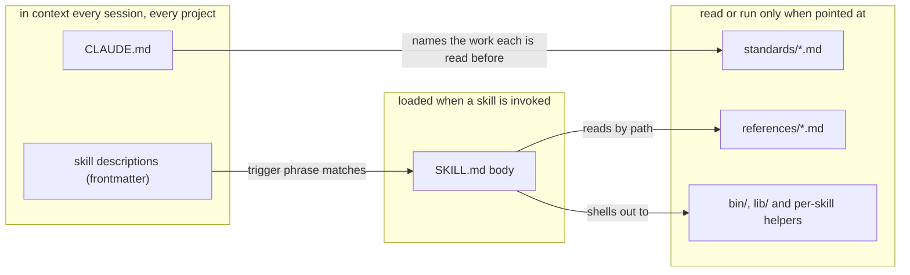
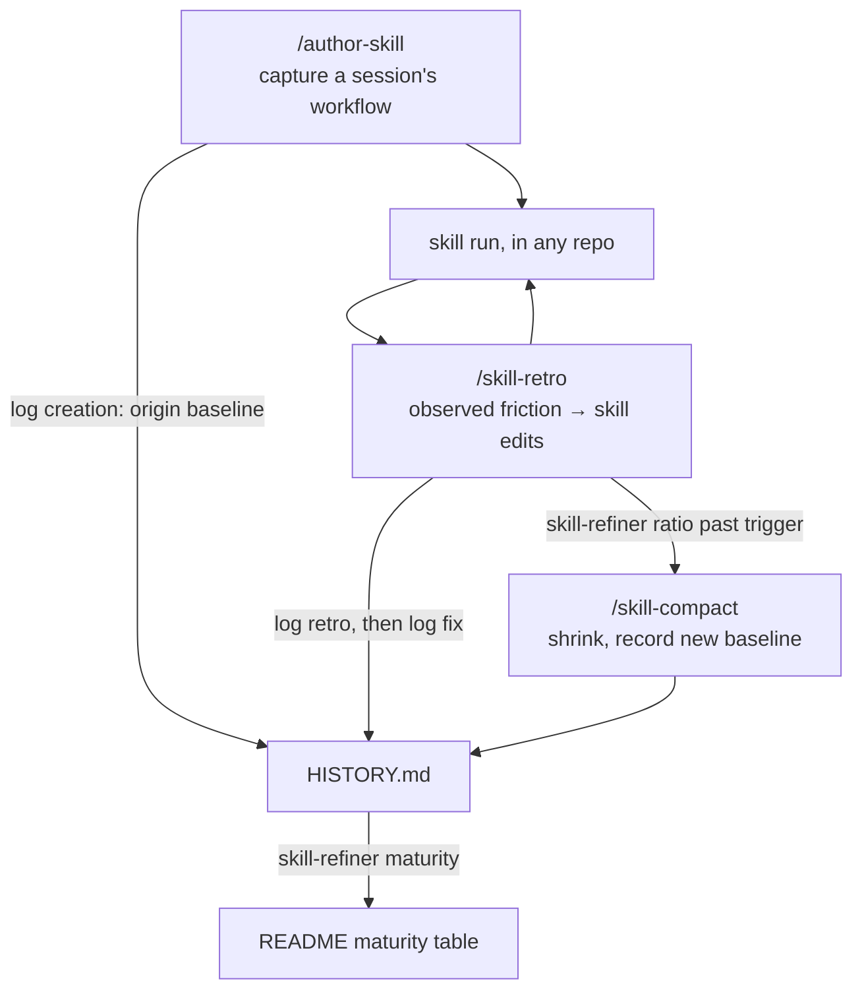

# Design

Why this config is laid out the way it is. Nothing here is needed to use the
skills; the [README](../README.md) covers that.

Two ideas drive the structure. First, **context is billed**: anything that
auto-loads — `CLAUDE.md`, every skill's frontmatter `description` — costs
tokens in every session, so each fact lives at the least-loaded level that
still reaches its reader. Trigger phrases go in the description, procedure in
the SKILL.md body, shared conventions in `references/` files read by path,
preferences that hold only for one kind of work in `standards/` files that
`CLAUDE.md` names by that work, and fixed pipelines into compiled helpers,
because prose that makes a model reproduce a pipeline reloads every run and
regresses where a program doesn't.



Second, **skills are maintained like code**: every run leaves evidence, the
evidence drives edits, and growth is measured so accretion has a counter-force.
`/skill-retro` turns a run's observed friction into edits and logs both how the
run went and what the edit did to the skill's `HISTORY.md`; `bin/skill-refiner`
rates maturity from that log and reports growth since the last size anybody
settled on deliberately; `/skill-compact` is the separate pass that
shrinks — separate because removing text in the same pass that fixes friction
is how the friction always wins.



## The history log

The `HISTORY.md` beside a `SKILL.md` is that evidence, appended to by the
skills above — and by a run's own executor, when the feedback footer has a run
that met no friction log itself — and by nothing else. One line per event:

```
2026-08-03 · claude-config · 1233 words · fix big: failure branch now …
```

— the date, the repo the run happened in, the SKILL.md's size at that moment,
and what happened: `created`, `run`, `retro clean|minor|major`, `fix small|big`, or
`compacted`. Three readers depend on that shape, which is why the file is
written only through `~/.claude/bin/skill-refiner.sh <skill> log …` and never by
hand, and why earlier lines are never rewritten:

- `skill-refiner maturity` rates the skill from the runs since the last
  major retro — and, for 🛡️ Battle-tested, since the last big fix too, and from
  how many repos those runs came from, which is what the repo field is for.
- `skill-refiner ratio` measures growth against the last deliberate size
  (`created` or `compacted`), so the word counts have to be a gap-free series.
- the next `/skill-retro` searches the clauses for a mechanism that already
  failed once, and treats a repeat as evidence against the mechanism rather
  than its wording — hence clauses that name the mechanism, not the symptom.

All three run out of this repo, so a project skill's log needs a clone of it (or
your fork) in `~/.claude` plus the .NET SDK. The log itself commits into the
project repo and travels with the skill; without this config a collaborator can
still read it, but it degrades to a changelog nothing rates. Since nobody there
has read this document, the first entry logged into a project tree seeds a
`.claude/skills/README.md` beside it saying the same thing for that audience —
[`bin/skill-refiner/ProjectSkillsReadme.md`](../bin/skill-refiner/ProjectSkillsReadme.md)
is the text, planted once and never overwritten. It also carries that tree's
maturity table, the counterpart of the one in the README and the only place a project
skill's suggested model is recorded. It arrives with headers and no rows: the
rating comes from the log, but the summary and the model do not, so
`skill-refiner maturity` asks for the row rather than inventing one. Seeding
also names the skills already sitting in that tree: the empty table lists none
of them, and nothing else in the loop reaches a skill that is never logged.
